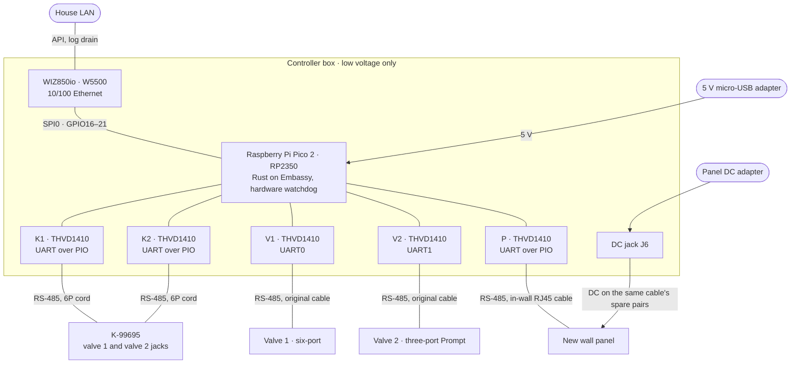
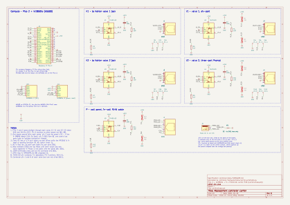
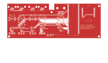
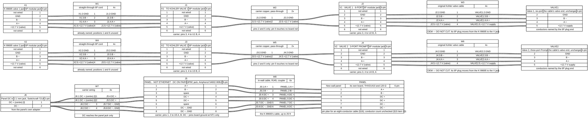

# Replacement controller — hardware specification

Status: **build specification, revision B (2026-10-24).** Not yet built.
Revision A, a Raspberry Pi with two USB converters, is superseded —
[DECISIONS.md W5](DECISIONS.md#w5--revision-a-build-superseded).

An open replacement master for the Kohler DTV+: one microcontroller board in
line with both Saturn valve cables, with a wired port for a new wall panel.
This specifies the unit described in [DESIGN.md](DESIGN.md). That document
owns the architecture, the safety rules and the delivery phases; this one owns
the hardware. Purchase links and prices are in
[SHOPPING-LIST.md](SHOPPING-LIST.md), and the order in which parts are bought
and phases run is [BUILD-ORDER.md](BUILD-ORDER.md). §12 documents the dormant
DTV+ steam stack the codebase carries; steam is otherwise out of scope.

Evidence tiers follow [system-specification.md](../../docs/system-specification.md) —
**[A]** ours/measured, **[B]** shipped code, **[K]** Kohler primary, **[C]**
reverse-engineered, **[?]** unresolved, **[I]** inference. Component data cited
from a manufacturer's or reseller's own published page is marked **[V]** and
linked.

---

## 1. Links

| Link | Far ends                              | Bus    | Protocol  | Encoding | Subsystem |
| ---- | ------------------------------------- | ------ | --------- | -------- | --------- |
| 1    | K-99695 valve 1 jack · six-port valve | RS-485 | Saturn    | Cx2      | §5        |
| 2    | K-99695 valve 2 jack · Prompt valve   | RS-485 | Saturn    | Cx2      | §5        |
| 3    | New wall panel                        | RS-485 | Ours, §16 | —        | §16       |

Each valve link is cut into two **segments** at the controller: `K`, between
the K-99695 and the controller, and `V`, between the controller and the valve.
Each segment has one transceiver at the controller's end, and exactly one
master at any time ([DESIGN.md § Safety boundary](DESIGN.md), rule 1). Each
valve link has its own state machine; the two zones share the board, its supply
and its ground (§9). The codebase also carries a dormant DTV+ steam stack — §12
— which is out of scope of this plan and drives no hardware.

### Reference configuration

The build is specified against a working installation, and every number in this
document that comes from hardware comes from it:

| Zone | Valve               | Firmware | Configured outlets | `max_temp` | Calibration |
| ---- | ------------------- | -------- | ------------------ | ---------- | ----------- |
| 1    | Six-port            | `0.12`   | 5                  | 113 °F     | `173`       |
| 2    | Three-port "Prompt" | `0.14`   | 3                  | 113 °F     | `160`       |

Valve models are most likely K-682-K and K-557-K1. Read the nameplates before
ordering connectors — §11.

---

## 2. Platform decision

**A WIZnet W5500-EVB-Pico2 — an RP2350 microcontroller and a W5500 wired
Ethernet controller on one board — running Rust firmware on Embassy.**

The in-line design needs five serial ports, and every deadline that binds is
≥ 150 ms (§6), so the choice is about ports, parts and the size of the trusted
base, not speed. The comparison with the revision A Pi, and why an ESP32 lost,
is [DECISIONS.md D14](DECISIONS.md#d14--rp2350-firmware-in-rust-not-a-linux-computer).

---

## 3. Block diagram, schematic and cabling



Pin 2 (ground) and pin 5 (+12.7 V, supplied by the valve) run straight
through K1 to V1 and K2 to V2. Only pins 3 and 4 reach a transceiver. The
panel's DC comes from its own adapter, over the carrier's copper to the panel
jack and nowhere else; it powers nothing on the board (§16).

Line power to both valves stays in the original listed receptacles and wiring.
No mains conductor enters the controller's box (§9).

### Carrier schematic

[](../hardware/carrier.svg)

The KiCad project is [`controller/hardware/`](../hardware/README.md): every
connection in this document on one sheet, net-checked against the GPIO map
(§8), the wiring per port (§5), the panel pin plan (§16) and the test points
(§10).

### Carrier PCB

[](../hardware/fab/carrier-routing.svg)

Two layers, 160 × 60 mm, generated from the same tables as the schematic and
routed, poured and checked by KiCad's DRC with nothing found. Every jack mouth
and the Pico 2's USB socket sit on the edge against the box wall the cables
come through, and the board is notched around that wall's middle lid boss.
[`controller/hardware/fab/`](../hardware/fab/README.md) has what a board house
needs (Gerber and drill files in one zip), the BOM, the pick-and-place file,
the assembly drawing, the routing on its own, and the board drawn inside the
box.

### Cabling

[](../hardware/cabling.svg)

From [`cabling.wireviz.yml`](../hardware/cabling.wireviz.yml);
[`cabling-wires.csv`](../hardware/cabling-wires.csv) lists every conductor
from end to end, and is checked against the board's nets each time it is
generated. The factory cables' conductor colours aren't recorded, so only the
two wires added here, the panel DC jack's, have colours.

---

## 4. Subsystem A — compute

| Item     | Specification                                                                                                                                        |
| -------- | ---------------------------------------------------------------------------------------------------------------------------------------------------- |
| Board    | Raspberry Pi Pico 2 with a WIZnet WIZ850io (W5500) on GPIO16–21, as ordered 2026-10-25; the W5500-EVB-Pico2 is the same circuit on one board **[V]** |
| MCU      | RP2350: two Cortex-M33 cores at 150 MHz, 520 kB SRAM, 2 UARTs, 12 PIO state machines **[V]**                                                         |
| Flash    | ~~2 MB~~ 4 MB on the Pico 2 **[V]** (Pico 2 datasheet, §1): firmware and configuration only. Nothing is logged to flash                              |
| Network  | W5500, 10/100 wired Ethernet, on GPIO16–21 **[V]**. No radio on the board                                                                            |
| Power in | 5 V over the Pico 2's micro-USB, from an external adapter (Raspberry Pi SC0623, 5.1 V 2.5 A) **[V]**                                                 |
| Watchdog | RP2350 hardware watchdog, fed by the bus tasks; a reset boots to `OFF` (DESIGN.md rule 4)                                                            |
| Firmware | Rust, Embassy (`embassy-rp`, `embassy-net`, `embassy-net-wiznet`), `picoserve` for the LAN API                                                       |
| Debug    | Micro-USB for flashing (UF2); SWD header for a debug probe and `defmt` logs                                                                          |

Board data: [The Pi Hut](https://thepihut.com/products/wiznet-w5500-evb-pico2).
A Pico 2 with a W5500 module wired to GPIO16–21 is the same circuit **[I]**,
and an original Pico (RP2040, 264 kB SRAM) is the same with less memory —
[SHOPPING-LIST.md](SHOPPING-LIST.md).
RP2350 data: [Adafruit](https://learn.adafruit.com/adafruit-feather-rp2350/overview).

**Logs.** Frame and session logs live in a RAM ring buffer and are read over
the LAN API; in the reference configuration the house's automation server
drains them every 5 minutes. A reset loses whatever had not been drained
**[I]**. The reset reason and the last fault survive a watchdog reset in the
watchdog's scratch registers **[I]**.

**No UPS.** Deliberate. A house power loss removes valve power, which closes
the valves — the correct outcome. Keeping the master alive through that event
adds a failure mode and buys nothing, because the master cannot act on valves
that have no power. Loss of controller power is one of the fault paths Phase 3
measures.

---

## 5. Subsystem B — valve serial links

### Selected part

TI **THVD1410**, one per port, five on the board. All rows **[V]**, from the
[datasheet](https://www.ti.com/lit/gpn/THVD1410).

| Parameter       | Value                                                                     |
| --------------- | ------------------------------------------------------------------------- |
| Function        | Half-duplex RS-485, one driver and one receiver, not isolated             |
| Supply          | 3 V – 5.5 V; run at the board's 3.3 V                                     |
| Data rate       | Up to 500 kbps, slew-limited                                              |
| Receiver        | Fail-safe high on an open, shorted or idle bus; thresholds −20 to −200 mV |
| Common mode     | ±15 V operating; bus pins protected to ±18 V                              |
| ESD             | Bus pins ±30 kV HBM, ±18 kV IEC 61000-4-2 contact                         |
| Driver enable   | `DE`, active high, internal 2 MΩ pull-down                                |
| Receiver enable | `RE`, active low, internal 2 MΩ pull-up                                   |
| Driver input    | `D`, internal pull-up                                                     |
| Package         | 8-pin SOIC (`D`) or VSSOP (`DGK`)                                         |

Why a driver-enable part and not an auto-direction one, and why not isolated:
[DECISIONS.md D15](DECISIONS.md#d15--one-board-for-both-valves-and-the-panel-plain-transceivers).
In short, the K-99695 drives both levels of every bit **[A]**, and an
auto-direction part drives a mark for 4–14 µs and then leaves it to the bus
bias **[V]**.

### Wiring per port

| Transceiver pin | Connection                                                                 |
| --------------- | -------------------------------------------------------------------------- |
| `A`             | Pin 4 of the six-position connector, the positive conductor **[A]**        |
| `B`             | Pin 3, the negative conductor **[A]**                                      |
| `GND`           | Board ground, which is pin 2 of that zone's cable (§9)                     |
| `VCC`           | Board 3.3 V, 100 nF at the pin                                             |
| `D`             | The port's TX GPIO                                                         |
| `R`             | The port's RX GPIO                                                         |
| `DE`            | The port's DE GPIO, **with an external 4.7 kΩ pull-down**                  |
| `RE`            | Ground: the receiver is always on, so each port hears its own transmission |

Wire by pin number. RS-485 vendors disagree on whether the positive line is A
or B; on the THVD1410, A is the non-inverting line **[V]**, so A goes to pin 4.

**The DE pull-down is what keeps a resetting board off the bus.** The
transceiver's own 2 MΩ pull-down is too weak to rely on against the RP2350's
pads: Raspberry Pi's erratum E9 can hold a pad with its internal pull-down
enabled high, and the documented workaround is an external pull-down of
8.2 kΩ or less ([Adafruit](https://learn.adafruit.com/key-pad-matrix-scanning-in-circuitpython/raspberry-pi-rp2350-erratum-workarounds)).
With 4.7 kΩ on every `DE`, no port drives its pair while the RP2350 is held in
reset, booting, being flashed, or restarting from its watchdog — bench check 1
proves it.

**Echo.** With `RE` tied low each port receives its own bytes. The firmware
compares them with what it sent and treats a mismatch as a link fault on that
segment, and it never forwards its own echo **[I]**.

### Termination and bias

| Port       | Termination at the controller | Bias at the controller                                                                       |
| ---------- | ----------------------------- | -------------------------------------------------------------------------------------------- |
| `K1`, `K2` | 120 Ω across 3–4              | None. The K-99695 end biases its segment **[I]**                                             |
| `V1`, `V2` | 120 Ω across 3–4              | Footprints for a pull-up on pin 4 and a pull-down on pin 3; values set in Phase 3, see below |
| `P`        | 120 Ω                         | Ours to choose, §16                                                                          |

The factory pair is terminated at both ends: 141.2 Ω across the valve side
alone, 55.6 Ω with the K-99695 connected **[A]**
([2026-10-24 bus capture](../../research/diagnostics/2026-10-24-saturn-valve-bus/README.md#meter-readings-a)).
Each segment keeps that shape: the far device's termination at one end, the
controller's 120 Ω at the other.

The valve segment's idle level is the one thing the K-99695 supplied that the
controller has to reproduce. On the factory bus it idles at +0.36 V (valve 2)
and +0.40 V (valve 1) differential **[A]**; the valve on its own read about
+0.2 to +0.3 V, a short reading through a slipping probe **[A]**. The bias
resistors are fitted, and their values chosen, in Phase 3 with the valve
connected, to bring the idle level to the factory figure. The controller's own
receivers need no bias: the THVD1410 is fail-safe **[V]**.

### Pin 5

The controller never takes power from pin 5 and never feeds it. The valve
supplies it **[A]**; how much spare current it has is not measured, and nothing
here depends on it.

---

## 6. Protocol parameters the hardware must satisfy

Restated here because they set the timing budget. **[C]** unless marked.

| Parameter                 | Saturn (valves)                     | DTV+ (steam, §12) |
| ------------------------- | ----------------------------------- | ----------------- |
| Line                      | 9600 8N1 **[A]**                    | 9600 8N1          |
| Tick                      | 525 ms average **[A]**              | 150 ms            |
| Request to reply, factory | 8.6–14.2 ms **[A]**                 | —                 |
| Response timeout          | 400 ms                              | 300 ms            |
| Message timeout           | 320 ms                              | —                 |
| Echo timeout              | 20 ms                               | 150 ms            |
| Retries                   | 3                                   | 4 or 5 **[?]**    |
| Frame length              | 6–17 bytes seen **[A]**; 20 maximum | variable          |

Byte time at 9600 8N1 is ~1.04 ms; the K-99695 sends at a 1146 µs byte pitch
**[A]**. Forwarding byte by byte adds about one byte time per frame per hop
**[I]**: ~1 ms to the request, ~1 ms to the reply.

---

## 7. Removed — independent temperature measurement

A PT1000/MAX31865 outlet temperature subsystem occupied this section through
revision A and was **removed from the plan on 2026-08-30**, operator decision —
[DECISIONS.md W3](DECISIONS.md#w3--the-independent-temperature-sensor-removed).
The section number is kept so every §8–§16 citation stays stable.

---

## 8. Subsystem D — timekeeping, and the GPIO map

The board has no battery-backed clock. Log entries carry the boot ID and a
monotonic microsecond timestamp from the RP2350's timer; wall-clock time comes
from SNTP over the LAN, and every wall-clock stamp records whether it has
synced. Water control never depends on the time of day.

### GPIO assignments

Proposed **[I]**: confirm against the board's schematic at the bench. GPIO16–21
belong to the W5500 and cannot be used for anything else **[V]**.

| Port | Faces                 | TX             | RX     | DE     | UART             |
| ---- | --------------------- | -------------- | ------ | ------ | ---------------- |
| `V1` | Valve 1               | GPIO0          | GPIO1  | GPIO2  | UART0            |
| `V2` | Valve 2               | GPIO4          | GPIO5  | GPIO6  | UART1            |
| `K1` | K-99695, valve 1 jack | GPIO7          | GPIO8  | GPIO9  | PIO              |
| `K2` | K-99695, valve 2 jack | GPIO10         | GPIO11 | GPIO12 | PIO              |
| `P`  | Wall panel            | GPIO13         | GPIO14 | GPIO15 | PIO              |
| —    | W5500                 | GPIO16–21      |        |        | SPI0, reset, IRQ |
| —    | Status LED            | GPIO25 **[V]** |        |        |                  |

The permanent ports, `V1` and `V2`, get the hardware UARTs; `K1` and `K2` are
used only until cut-over. Spare: GPIO3, 22, 26–28. No GPIO drives a relay, a
contactor, or anything in a mains path.

---

## 9. Power, isolation and grounding

### Power tree

```text
5 V micro-USB adapter, outside the box
└── Pico 2 (A1), its own regulator → 3V3, pin 36
    ├── RP2350, on the Pico 2
    ├── WIZ850io (J10, J11), 141 mA typical
    └── THVD1410 ×5 (U1–U5), 100 nF each (C1–C5)

Panel DC adapter, outside the box
└── DC jack J6 → panel jack J5: + on pins 4, 5; − on pins 7, 8
    └── − joins board ground at NT1 only; + touches no board net

Each valve's +12.7 V, from the valve
└── pin 5, straight through K1→V1 and K2→V2; no board net
```

### Budget

| Load                  | Worst case             | Note                                                                               |
| --------------------- | ---------------------- | ---------------------------------------------------------------------------------- |
| Pico 2                | Measured at the bench  | RP2350 and the board's regulator                                                   |
| WIZ850io              | 141 mA typical **[V]** | From the Pico 2's 3V3 ([WIZnet](https://docs.wiznet.io/Product/ioModule/wiz850io)) |
| One THVD1410 driving  | ~30 mA **[I]**         | ~2 V across the two terminations in parallel, ~65 Ω                                |
| Ports driving at once | 3 **[I]**              | Each zone is half duplex, so one segment per zone drives, plus the panel           |

The board's 3.3 V regulator is the limit, not the 5 V supply: bench check 9
runs three ports driving continuously and checks 3.3 V stays in regulation.

### Grounding

1. **Pins 2 and 5 pass straight through** each zone, from the `K` connector to
   the `V` connector, on copper that touches nothing else, except that pin 2 is
   also the ground reference for that zone's two transceivers.
2. **One board ground** therefore joins both zones' pin 2 and the panel
   port's ground. Whether the K-99695 already joins its two valve jacks' pin 2
   is not measured (§15 item 8). If it does not, one zone's two ports take an
   isolated transceiver with its own isolated supply instead of the THVD1410
   — [DECISIONS.md D15](DECISIONS.md#d15--one-board-for-both-valves-and-the-panel-plain-transceivers).
3. The Ethernet port is transformer-coupled and the USB adapter's output
   floats from mains **[I]**, so the board's only ground reference is the
   valves' pin 2. A laptop on USB for flashing ties its own ground in; run it
   on battery.

### Mains policy

**No mains conductor enters the controller's box.** The USB adapter, and the
panel's DC adapter (§16), plug into an existing receptacle outside it; only
their low-voltage cables come in. This project does no mains work anywhere:
the valves stay in their existing receptacles and circuits, untouched.

---

## 10. Enclosure, mechanical and environment

| Requirement   | Specification                                                                                                                                                      |
| ------------- | ------------------------------------------------------------------------------------------------------------------------------------------------------------------ |
| Location      | Beside the K-99695: dry, serviceable. **Not inside the bathroom wet zone**                                                                                         |
| Box           | Small, non-metallic, with a mounting plate; the board sockets into a carrier, not soldered in                                                                      |
| Carrier       | A two-layer PCB, [`controller/hardware/fab/`](../hardware/fab/README.md); the Pico 2 and the WIZ850io plug into sockets on it. Four M2.5 holes for nylon standoffs |
| Cable entries | Micro-USB power, Ethernet, `K1`, `V1`, `K2`, `V2`, panel cable, panel DC                                                                                           |
| Strain relief | Every cable. No conductor takes tension at a solder joint or a jack                                                                                                |

### Labelling and test points

| Label                                | Applied to                                      |
| ------------------------------------ | ----------------------------------------------- |
| `K1 · TO KOHLER VALVE 1`             | The `K1` connector and its lead                 |
| `V1 · VALVE 1 · 6-PORT`              | The `V1` connector                              |
| `K2 · TO KOHLER VALVE 2`             | The `K2` connector and its lead                 |
| `V2 · VALVE 2 · 3-PORT PROMPT`       | The `V2` connector                              |
| `PANEL · NOT ETHERNET · DC ON PAIRS` | The panel jack, both ends of the in-wall cable  |
| `OEM — DO NOT CUT`                   | Both original Kohler valve cables, at both ends |

Bring pins 2, 3 and 4 of every segment out to labelled test points, so each
segment can be scoped without unplugging anything. The carrier PCB prints the
connector labels beside each jack and names every test point (`K1-2` … `V2-4`);
the labels on the leads and cables are still applied by hand.

---

## 11. Field cabling — specified, not yet orderable

These items cannot be finalised from documents. Each row names the measurement
that closes it. Ordering by assumption is prohibited by
[DESIGN.md § Hardware, "Not orderable from documents"](DESIGN.md).

| Item                               | Known                                                            | Closed by                                                                   |
| ---------------------------------- | ---------------------------------------------------------------- | --------------------------------------------------------------------------- |
| Valve-side connectors (`V1`, `V2`) | Six positions, pins 2–5 wired **[A]**                            | A photograph of the plug on the valve cable: housing and part number        |
| Leads to the K-99695 (`K1`, `K2`)  | The K-99695's valve jacks take the same plug **[A]**             | The same photograph; lead length measured at the controller                 |
| Cable polarity                     | **Closed:** pin 4 positive, pin 3 negative, pin 2 ground **[A]** | —                                                                           |
| Factory termination                | **Closed:** both ends terminated **[A]**                         | —                                                                           |
| Valve-segment bias values          | Factory idle +0.36 / +0.40 V **[A]**                             | Phase 3, with the valve on the controller (§5)                              |
| In-wall panel cable conductors     | RJ45-terminated, up to 25 ft, a coupler **[K]**                  | A look at the plug at the controller end: how many contacts are wired (§16) |

**Adapter leads, not modified OEM cables.** The original Kohler cables are the
rollback path and are never cut. The valve cable's plug goes into `V1` or `V2`;
a new short lead goes from `K1` or `K2` to the K-99695's jack.

---

## 12. The dormant DTV+ steam stack

**Steam is out of scope of this plan** — operator decision 2026-08-30,
recorded in [DECISIONS.md](DECISIONS.md#d12--like-for-like-scope-no-added-equipment-no-steam-setup).
The house has no steam generator and nothing here is bought, wired or
commissioned for one.

What remains is code that existed before the descope: a complete DTV+ codec,
steam engine and emulator, exercised by the test suite and **disabled in the
deployed configuration** (`steam.enabled = false`). This section documents what
that dormant code enforces, because the requirement register cites it. The
K-1737-K1 adapter reference material — including everything measured on the
opened board — is [STEAM-ADAPTER.md](STEAM-ADAPTER.md).

### Protocol — DTV+, not Saturn

The valve links speak Saturn; steam speaks DTV+ on the same kind of wire at the
same baud rate. All **[C]**, from
[dtv-plus-protocol.md](../../research/xagon0/docs/protocols/dtv-plus-protocol.md)
and [steam-generator.md](../../research/xagon0/docs/devices/steam-generator.md).

| Layer         | DTV+                                                                                                                                      |
| ------------- | ----------------------------------------------------------------------------------------------------------------------------------------- |
| Framing       | `SOF 0x88 · DEST · SRC · CMD · payload · CHECKSUM · EOF 0x55`                                                                             |
| Byte stuffing | `0x88`, `0x55`, `0xAA` escaped by a leading `0xAA`; SOF/EOF never escaped                                                                 |
| Checksum      | 2's complement of `DEST+SRC+CMD+payload`; verified by summing to `0x00`                                                                   |
| Discovery     | `DEV_ADDRESS_OPP 0x05` broadcast → `DEV_REQUEST_ADDR 0x06` with device ID → `DEV_ASSIGN_ADDR 0x07`                                        |
| Addressing    | Device ships at `0x00`; master assigns `0x03`–`0x07`; `0xFF` broadcast. Steam device ID is `0x05`                                         |
| Commands      | `GET_DEV_STATUS 0x30`, `STATUS_UPDATE 0x31`, `SET_DEV_PARAM 0x34`, `DEV_ACK 0x35`, `DEV_NAK 0x36`, `ERROR 0x37`, `CLEAR_FAULT_FLAGS 0x3A` |
| Tick          | 150 ms; reply timeout 300 ms                                                                                                              |
| Temperature   | **Fx2 — Fahrenheit × 2.** Valves use Cx2                                                                                                  |

**The encoding split is the one real implementation hazard.** `Fx2 = ((Cx2 × 9) / 5) + 64`.
Make Cx2 and Fx2 distinct types that cannot be assigned to each other, and put
the conversion in exactly one place. A units error here is not caught by range
checking: Fx2 for 110 °F is `220`, which read as Cx2 asks a valve for 110 °C.

### Limits

| Limit                    | Value                                                   | Tier       |
| ------------------------ | ------------------------------------------------------- | ---------- |
| Setpoint range           | 90 °F (32 °C) – 125 °F (52 °C), 1 °F steps              | **[K]**    |
| Factory default          | 110 °F                                                  | **[K][A]** |
| Session duration         | 1–20 minutes; default 10                                | **[K][B]** |
| Generator's own envelope | Max 125 °F, min operating 90 °F, min run 10 min, max 20 | **[K]**    |

The controller's limits and the generator's are the same numbers, which is
consistent with the generator owning the envelope and the DTV+ path inheriting
it **[I]**.

Clamp in our own code at both ends before transmission, the same way the valve
setpoints are clamped. Note that `steam_max_temp` is an installer settings field
with no `min`/`max` in the shipped web UI **[B]** — treat it as configuration,
not as a guarantee, exactly as the water `max_temp` is treated.

### Command allowlist

Same rule as the valve encoder: only captured, tested, operational frames ship.

**Exposed:** `steam_start(temperature_f, duration_minutes)`,
`steam_set_temperature`, `steam_set_duration`, `steam_stop`, `get_cached_state`.

**Permanently denied:**

| Denied                                   | Reason                                                                                                 |
| ---------------------------------------- | ------------------------------------------------------------------------------------------------------ |
| Power clean (`STEAM_POWER_CLEAN` `0xCC`) | 45-minute unattended cycle discharging through the steam head. Run it from the generator's own control |
| Deluge                                   | Opens a Saturn valve from a steam session. Cross-bus actuation stays out of the first implementation   |
| Spa "Steam Coach"                        | Mutually exclusive with steam; the shipped UI carries the interlock **[B]**                            |
| Address clear outside `DISCOVERY`        | Same rule as the valve links                                                                           |
| Anything not in the captured frame set   | Same rule as the valve links                                                                           |

Power clean being denied on our side does not disable it — the generator
tracks its own 600-minute cumulative counter and reminds through its own
control **[K]**.

### Losing the DTV+ link

Three links exist and only two are ours: controller ↔ valve (Saturn), controller ↔ adapter
(DTV+), and adapter ↔ generator (Kohler's crossover cable). This is about the
second.

Two cases, and they behave differently:

| Case                                                                         | What the service does                                                                           |
| ---------------------------------------------------------------------------- | ----------------------------------------------------------------------------------------------- |
| **Degraded but alive** — timeouts, NAKs, checksum failures, port still open  | Transmit still works: command `steam_stop`, require acknowledgement, latch the link unavailable |
| **Hard loss** — port gone, cable pulled, firmware dead, controller unpowered | Nothing can be sent. Steam is entirely on the generator's own behaviour                         |

The service enforces its own session limit for the degraded case.

For the hard case it assumes nothing: a dead process enforces no limits, and
what a generator does when this link goes silent has never been measured.

---

## 13. Bench acceptance — before anything is connected

Phase 2 of [DESIGN.md](DESIGN.md). The bench rig is the two Waveshare
`USB TO RS485/422` converters left from revision A on a computer: one on a `K`
port plays the K-99695, the other on that zone's `V` port plays the valve, both
driven by the emulator. **Nothing installed is connected.**

| #   | Check                                  | Pass criterion                                                                                                                  |
| --- | -------------------------------------- | ------------------------------------------------------------------------------------------------------------------------------- |
| 1   | No port drives while the board is down | Scope on every port's pins 3–4 through power-up, `RUN` held low, flashing, and a watchdog reset: no driven level on any port    |
| 2   | Termination                            | Power off, nothing plugged in: 120 Ω across pins 3–4 at each port                                                               |
| 3   | Pass-through copper                    | Pin 2 and pin 5 continuous `K1`↔`V1` and `K2`↔`V2`; pin 5 open to 3.3 V, 5 V and board ground                                   |
| 4   | Panel DC stays off the valve ports     | Panel adapter on: 0 V against board ground on every contact of `K1`, `V1`, `K2`, `V2`                                           |
| 5   | Pass-through copies                    | 24 h of captured traffic replayed both ways: every byte arrives unchanged; the added delay per byte is recorded                 |
| 6   | Segment faults are found               | `V` segment opened, then shorted, on each zone: that zone latches a link fault; the other zone carries on                       |
| 7   | A dead controller is silent            | Forced firmware hang, then power pulled: the valve-side rig sees an undriven line within one byte time, never a held level      |
| 8   | The bus does not need the network      | Ethernet unplugged during pass-through and during emulated take-over: bus traffic unchanged; the API answers again on reconnect |
| 9   | 3.3 V budget                           | Three ports driving continuously into 60 Ω: 3.3 V stays in regulation                                                           |
| 10  | Watchdog                               | Forced hang: the board resets and boots into its configured stage with water off, no state restored                             |
| 11  | Seven-day soak against the emulator    | No unexplained reset, no unallowlisted write, every injected failure ends in `OFF`                                              |
| 12  | Zone-to-zone ground                    | Pin 2 `K1` to pin 2 `K2` matches §15 item 8: 0 Ω on plain transceivers, open if one zone is isolated                            |
| 13  | Every label present and correct        | Visual                                                                                                                          |

Checks 1 and 4 catch the two ways this board could put something onto a valve
bus that the K-99695 never did. Neither may be skipped.

Steam adds two more, run against the DTV+ emulator: a Cx2 value must be
rejected by the steam encoder, and an Fx2 value must be rejected by the valve
encoder. The type split in §12 should make both uncompilable; the checks confirm
it.

---

## 14. Deliberately excluded

| Excluded                                                       | Reason                                                                                                         |
| -------------------------------------------------------------- | -------------------------------------------------------------------------------------------------------------- |
| Any relay, contactor, smart plug or cord switch in valve mains | Design rule. A failing stop latency is not solved with an unreviewed relay                                     |
| A bypass relay around the controller                           | The valve fails off on silence **[A]**; a bypass can fail into two masters on one segment. [D13](DECISIONS.md) |
| Mains wiring inside the box                                    | Keeps the build low-voltage; §9                                                                                |
| UPS on the controller                                          | Power loss must reach the valves; §4                                                                           |
| Auto-direction RS-485 transceivers                             | Drive a mark for microseconds and leave it to the bias; §5, [D15](DECISIONS.md)                                |
| Generic `MAX485` / TTL-to-RS485 modules                        | No controlled driver enable; some assert the transmitter during boot                                           |
| Taking power from pin 5, or feeding it                         | The valve's supply, spare current unmeasured; §5                                                               |
| Standard PoE on the panel cable                                | Power-sourcing and powered-device hardware for one cable; §16, [D16](DECISIONS.md)                             |
| Wi-Fi in the control path                                      | Wired Ethernet only; the board has no radio                                                                    |
| A Linux computer, or an ESP32                                  | [D14](DECISIONS.md)                                                                                            |
| A bidirectional adapter as a parallel capture tap              | Not physically receive-only. Captures come from the scope, or from inside the path in pass-through             |
| An industrial PLC (~$500)                                      | Poor value for two links                                                                                       |

---

## 15. Open items

Items 1–7 keep their revision A numbers, which other documents cite.

| #   | Item                                                                                                                                                                                                                                                                                             | Closed by                                                                                         | Blocks                                     |
| --- | ------------------------------------------------------------------------------------------------------------------------------------------------------------------------------------------------------------------------------------------------------------------------------------------------ | ------------------------------------------------------------------------------------------------- | ------------------------------------------ |
| 1   | Valve model numbers and nameplate data                                                                                                                                                                                                                                                           | Phase 0 photograph                                                                                | Connector order                            |
| 2   | ~~Valve connector housing and part number~~ **Closed 2026-10-25:** the cable's K-99695 end is a 6P modular plug, 2–5 wired, and moves to `V1`/`V2`; its valve end is a different connector that stays in place; `K1`/`K2` reach the K-99695 over straight-through 6P cords already owned **[A]** | —                                                                                                 | —                                          |
| 3   | ~~Cable polarity~~ **Closed 2026-10-24:** pin 4 positive **[A]**                                                                                                                                                                                                                                 | —                                                                                                 | —                                          |
| 4   | ~~Factory termination and idle bias~~ Termination **closed 2026-10-24**, both ends **[A]**. Valve-segment bias values remain                                                                                                                                                                     | Phase 3, §5                                                                                       | Bias resistors                             |
| 5   | ~~Which FTDI part is fitted~~ Moot: the converters are the bench rig                                                                                                                                                                                                                             | —                                                                                                 | —                                          |
| 6   | Saturn response timeout, 320 ms or 400 ms, and the K-99695's own reply timeout                                                                                                                                                                                                                   | Phase 3 pass-through — [I5](../../INVESTIGATIONS.md#i5--the-saturn-register-map-is-contradictory) | Take-over deadlines                        |
| 7   | Whether automatic purge is on                                                                                                                                                                                                                                                                    | [I4](../../INVESTIGATIONS.md#i4--is-automatic-purge-on) — one read-only call                      | Stop-latency definition                    |
| 8   | Whether the K-99695 joins pin 2 of its two valve jacks                                                                                                                                                                                                                                           | Phase 0: continuity between the two jacks' pin 2, K-99695 unpowered and unplugged                 | Isolation for one zone (§9)                |
| 9   | Whether the K-99695 accepts the controller's answers for a valve it no longer drives                                                                                                                                                                                                             | Phase 3 take-over                                                                                 | Take-over; otherwise D1's swap at cut-over |
| 10  | Whether the ported logic fits 520 kB of SRAM and ~~2 MB~~ 4 MB of flash                                                                                                                                                                                                                          | The port (BUILD-ORDER.md step 2)                                                                  | The platform, [D14](DECISIONS.md)          |
| 11  | Panel hardware, and how it is sealed in the shower wall ([I2](../../INVESTIGATIONS.md#i2--the-k-99693-interface-was-disconnected))                                                                                                                                                               | The panel build                                                                                   | Phase 7                                    |
| 12  | ~~Protoboard or a carrier PCB for the installed unit~~ **Closed 2026-10-26:** a carrier PCB, generated from the schematic's script ([`fab/`](../hardware/fab/README.md))                                                                                                                         | —                                                                                                 | Installation                               |
| 13  | How many conductors the in-wall panel cable has                                                                                                                                                                                                                                                  | Phase 0: a look at the plug at the controller end                                                 | The panel pin plan, §16                    |

---

## 16. The wall panel link

The new panel replaces the K-99693 —
[DECISIONS.md D16](DECISIONS.md#d16--a-new-wall-panel-on-its-own-board-wired).
Its own hardware is chosen when it is built (§15 item 11). This section
specifies what the controller gives it.

| Item      | Specification                                                                                                              |
| --------- | -------------------------------------------------------------------------------------------------------------------------- |
| Cable     | The K-99693's in-wall cable: up to 25 ft, RJ45-terminated, with a coupler **[K]**; it carried a UART, not Ethernet **[C]** |
| Signal    | RS-485, half duplex: a THVD1410 at each end, 120 Ω at each end, bias at the controller end                                 |
| Line rate | 115200 8N1 **[I]**, what the cable carried for the K-99693                                                                 |
| Power     | Passive DC from the panel's own adapter, put onto the cable at the controller end. Voltage set by the panel hardware       |
| Protocol  | Ours, specified with the panel firmware                                                                                    |

Pin plan for an eight-conductor cable:

| RJ45 pins | Use                            |
| --------- | ------------------------------ |
| 1, 2      | RS-485: 1 positive, 2 negative |
| 3, 6      | Spare                          |
| 4, 5      | DC +                           |
| 7, 8      | DC − and signal ground         |

With four conductors, RS-485 takes one pair and DC the other.

**The DC powers nothing on the board.** The panel adapter plugs into a DC
jack in the box wall, wired to the carrier's J6 pads, whose copper reaches only
the panel jack's DC pins. DC − joins
board ground at that one point, because the RS-485 link needs a common
reference; DC + touches no board net. Bench check 4 proves it never reaches a
valve contact.

**What the panel may do.** It sends the same constrained operations as the LAN
API, checked against the same clamps, and the controller pushes it state as it
changes ([DESIGN.md § Software design](DESIGN.md)). It cannot send a raw valve
frame. Losing the panel changes nothing about a running session: the
20-minute limit and the API still stop it, as they would with the K-99693 gone
**[A]** ([I2](../../INVESTIGATIONS.md#i2--the-k-99693-interface-was-disconnected)).

### Panel acceptance — Phase 7

| #   | Check                  | Pass criterion                                                                                                                |
| --- | ---------------------- | ----------------------------------------------------------------------------------------------------------------------------- |
| P1  | Power at the panel     | Through the installed cable, at the panel's full load: within its input range                                                 |
| P2  | The link               | A day of traffic over the installed cable without a framing or checksum error                                                 |
| P3  | Panel lost mid-session | Cable pulled during a run: the session carries on to its limit or an API stop; the panel shows current state when reconnected |
| P4  | Panel reset            | A panel power cycle sends no command                                                                                          |
