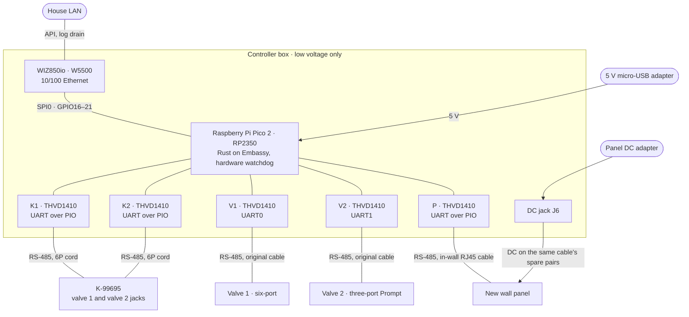

# #14 Draw the in-line controller: schematic, cabling, block and stage diagrams

| | |
| --- | --- |
| Opened | 2026-10-26 by ntotten |
| State | open on 2026-10-26, head `902a2fc` |
| Branch | `claude/project-thread-b885rb` into `claude/project-thread-vvffc7` |
| Was | https://github.com/ntotten/Kohler-DTV-Plus/pull/14 |

The pull request's description as it stood on 2026-10-26, unedited:

---

Adds drawings to the rev B in-line controller plan so it can be reviewed from pictures, in the style of [OpenRX](https://github.com/OpenDrone-hw/OpenRX). Nothing in the plan changes. Each drawing shows facts that HARDWARE.md and DESIGN.md already state, with the same `[I]` marks.

**Stacked on #13** (the parts-list correction), because it draws the micro-USB supply and the 6P6C jack order from that PR. Merge #13 first. GitHub then retargets this PR to `main`.

## Block diagram (HARDWARE.md §3)

## Carrier schematic and cabling

Both render in the PR's file view and in HARDWARE.md §3 on the branch:

- **[Carrier schematic](https://github.com/ntotten/Kohler-DTV-Plus/blob/claude/project-thread-b885rb/controller/hardware/carrier.svg)** (KiCad). One sheet: the Pico 2 and the WIZ850io, then one block per port (K1, V1, K2, V2, P) with its THVD1410, termination, DE pulldown, bias footprints (values TBD), jack and test points. It is written from the GPIO map and jack-pin tables in `tools/carrier_schematic.py`. `tools/check_netlist.py` then checks the netlist that KiCad reads back against those same tables: 37 nets, 160 pins. Every pin has a net label beside it.
- **[Cabling](https://github.com/ntotten/Kohler-DTV-Plus/blob/claude/project-thread-b885rb/controller/hardware/cabling.svg)** (WireViz). Every cable between the K-99695, the carrier, both valves and the panel, pin by pin.
- **[HARDWARE.md §3](https://github.com/ntotten/Kohler-DTV-Plus/blob/claude/project-thread-b885rb/controller/docs/HARDWARE.md#3-block-diagram-schematic-and-cabling)** shows all three together.

## Also in this PR

- **HARDWARE.md §9:** the power tree as text, plus the WIZ850io's 141 mA in the budget table.
- **DESIGN.md:** the decision is now a Mermaid diagram instead of ASCII art. A new sequence diagram shows one valve's traffic in each stage (pass-through, take-over, cut-over).
- **`docs/diagrams.md`:** the diagram convention, linked from `CLAUDE.md`. It says what each kind of plan carries, which tool draws what (Mermaid by default, KiCad for schematics, WireViz for cables, text for power trees and pin maps), and that drawings are rendered before pushing.
- **`controller/hardware/tools/render.sh`:** regenerates both SVGs, runs the netlist check, and fails if any Mermaid block in the repository doesn't parse. With `--check`, it also fails when a committed drawing differs from its source.

## What to check

- **THVD1410 pin numbers.** They are marked `[I]` on the sheet because they come from KiCad's THVD1400D symbol, which shares the SOIC-8 pinout. The TI datasheet wasn't reachable from here. Check it before wiring the adapters.
- **J6 polarity.** Centre-positive is still `[I]` until the panel's adapter is chosen.
- **The script is the schematic's source only while the carrier is a protoboard.** Once a PCB starts, the sheet gets edited in KiCad directly and the script is deleted. `controller/hardware/README.md` says so.

## Validation

`controller/hardware/tools/render.sh` passed: the netlist check, both SVGs, and all three Markdown files with Mermaid blocks. `npm run format:check` passes.

🤖 Generated with [Claude Code](https://claude.com/claude-code)

https://claude.ai/code/session_01PNaoTTizvWnVxnC9Mh2V5e
